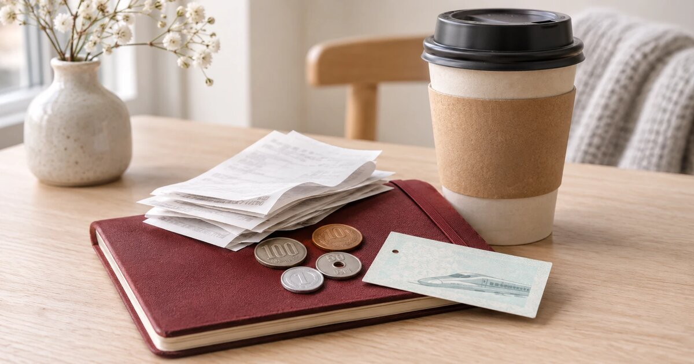

Before Japan I made a spreadsheet (of course I did). Every expense got a line: what I budgeted, what it really cost, and the difference. I kept filling it in during the trip, and the last lines after I came home.

So here it is, more or less the whole sheet. Ten days, solo, from Oslo, in July this summer.

My budget was **37,444 kroner**. Did I hold it? Yes, actually, with about 1,600 kroner to spare. But not in the places I expected.

### Flight and hotels, the big blocks

**Flight: 15,796 kroner.** Oslo to Tokyo and back, economy, two checked bags of 23 kilos. Almost half of the whole trip, and nothing to save there once it was booked.

(My outbound flight was cancelled the day before departure, and I was rebooked on another route with two other airlines. I wrote about that panic separately. For the budget it changed nothing, not one krone.)

**Hotels: 7,673 kroner for nine nights**, so about 850 kroner a night on average:

| Nights | Where | Budget (NOK) | Real (NOK) |
|---|---|---|---|
| 1 | Business hotel by Tokyo Station | 1,100 | 1,085 |
| 3 | Hotel by Kyoto Station, breakfast included | 1,600 | 1,636 |
| 1 | Traditional inn in Hakone, private hot spring bath, dinner and breakfast included | 1,600 | 1,603 |
| 4 | Business hotel in Shinjuku, Tokyo | 3,450 | 3,349 |
| **9** | **Total** | **7,750** | **7,673** |

Hotels were almost exactly on budget, because I booked them all before leaving.

The inn in Hakone is the one I want to point at. One night cost the same as three nights in Kyoto, but it included a huge dinner with many small courses, and breakfast. It was the best night of the whole trip, and I would pay it again.

Four nights in Shinjuku for 3,349 kroner, in high season? I still think that is cheap. The room was small, sure. I was only sleeping there.

### Getting around

| What | Budget (NOK) | Real (NOK) |
|---|---|---|
| Flybuss to and from Gardermoen | 449 | 449 |
| Bullet train (shinkansen) Tokyo → Kyoto | 850 | 857 |
| Bullet train Kyoto → Odawara | 760 | 726 |
| Bullet train Odawara → Tokyo | 255 | 236 |
| Suica card (metro, local trains, buses) | 1,000 | 423 |
| Luggage forwarding | 500 | 610 |
| **Total** | **3,814** | **3,301** |

The bullet train is not cheap, but it leaves every few minutes and arrives exactly on time. Tokyo to Kyoto takes about two and a half hours. I had looked at a rail pass, but for my route single tickets were cheaper.

The Suica card is the travel card on your phone. Metro, local trains, buses, even the convenience store, everything came off that card (the little local train from Odawara up to Hakone too). I budgeted 1,000 kroner and used 423.

Luggage forwarding is the service where your suitcase is picked up at one hotel and delivered to the next one, or to the airport, the day after. I used it three times: airport to Kyoto, Kyoto to Tokyo, and Tokyo hotel to the airport on the last day. About 610 kroner in total, a bit over my 500 (the Kyoto one I paid in cash and forgot to put in the sheet, haha). Worth every krone. I never once dragged a big suitcase up station stairs in 34 degrees.

### Money and data

**Cash: zero fees.** I moved yen into my Revolut account before leaving and took out 20,000 yen at an ATM at the airport. No fee at all.

**eSIM: 84 kroner** for 10 GB for the whole trip. Probably the best value line in the sheet, haha.

**Travel insurance:** not in the sheet, because I have had a monthly travel insurance for years, since long before cancer. It covers what it covers. I did not buy anything extra for Japan.

### Food: half of what I planned

I budgeted 500 kroner a day, so 5,000 kroner for ten days. I spent **2,505**. That is about 250 kroner a day.

Why so low? Food in Japan is just cheaper than eating out in Oslo, and the cheap food is good. Convenience store food, noodle shops, set lunches, a proper meal was often under 100 kroner. And to be honest, there were also days with food fatigue, when I barely ate.

My most expensive meal was a seven course dinner in Kyoto with grilled eel as the main, no drinks: 6,900 yen, about 415 kroner. I would not repeat that one. My cheapest bad meal was cold soba with tempura in Tokyo for 840 yen, about 51 kroner (not the price's fault, I just did not like it 😅).

### Shopping, the one line that went over

Budget 5,000 kroner. Real **6,462**. So yes, 1,462 kroner over, by far the biggest miss in the whole sheet.

But a big part of it was planned:

- **AirPods Pro 3: about 2,310 kroner**, with the tax-free discount taken off at the till. The same ones were 2,999 kroner in Oslo, and I needed new ones anyway.
- **Tea, four bags of 200 grams: about 430 kroner.** Partly gifts.
- Uniqlo (cheaper in Japan than here), Muji, a white shirt, sunscreen, sheet masks, and small gifts.

When I was there in July, tax-free worked directly at the till: I showed my passport and paid the lower price. Easy.

**Update: this has changed since November 1, 2026.** Japan now uses "pay now, refund later". You pay the full price with tax in the shop, and get the tax back when you leave, through customs at the airport (mostly self-service kiosks), as a refund to your card. So plan some extra time at the airport on your way home, and keep your purchases unused, because things you use or eat in Japan do not get a refund. Rules like this can change again, so check before you go.

### So, the whole sheet

| Category | Budget (NOK) | Real (NOK) |
|---|---|---|
| Flight | 15,796 | 15,796 |
| Hotels | 7,750 | 7,673 |
| Transport in Norway and Japan | 3,814 | 3,301 |
| eSIM | 84 | 84 |
| Food | 5,000 | 2,505 |
| Shopping | 5,000 | 6,462 |
| **Total** | **37,444** | **35,821** |

Without shopping, the trip itself cost me 29,359 kroner for ten days.

Where was I wrong? Food and local transport, by a lot, both in the good direction. Shopping went the other direction (no surprise there, haha), and luggage forwarding a little too. Everything I booked in advance landed almost exactly where I planned it.

Would I do it again at this price? Yes, and I would change very little. Maybe skip the eel dinner.

Do you keep a budget sheet when you travel, or is that just me? And if you are planning Japan, ask me about any line here, I am happy to share what I know.
