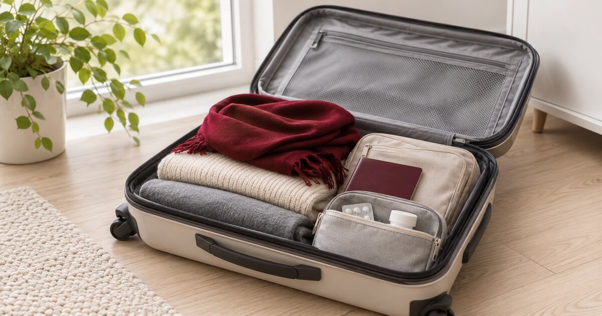

Can you travel during chemo? I wondered about that a lot in 2024, and I googled it a lot too. So here is my answer, from two trips: Denmark in the middle of chemo, and a month alone in Australia right after my treatment ended.

Everyone is different, so this is not a guide. It is just what I did, and how it went.

### Copenhagen, four days after my last EC

My fourth and last round of EC90 was on 15 July 2024. Two days later, on 17 July, I took the [Ziextenzo shot](/2026/04/13/ziextenzo-the-shot-that-kept-my-treatment-on-track/) for my blood counts, and on 19 July we flew to Copenhagen. Five days, back on the 23rd.

Did I ask my doctor first? Honestly, no, not formally. I just felt OK. But I read a lot online about how other people had done it, and that helped me decide.

The original plan was actually Sofia. I changed my mind because it felt too far away, and I did not know the healthcare system there. Yes, I had the European health card (europeisk helsetrygdekort), but still. If something went wrong, I wanted to be somewhere that felt familiar. Denmark is close, and the system is almost the same as in Norway. That made me calm.

So we flew to Copenhagen, took the train to Aarhus, then the train back to Copenhagen, and flew home to Oslo.

### How my body did

I was tired, of course. But by round four I had kind of gotten used to "the new me". I could walk everywhere we needed to go (we always walk a lot when we travel), and we biked too. I had some bone pain from the Ziextenzo, but not enough to stop me from anything.

The heat was the hardest part. It was so hot. I still do not know if I felt hotter than normal because of the treatment, or if it was just a really hot summer.

We did not do anything extreme, no sports or big adventures. We just relaxed and did what we had planned.

### The infection I was afraid of

During chemo your immune system is low, so infections are the big fear. I was really scared of getting sick on the trip.

And someone did get sick. Just not me.

The person I traveled with got a strep infection (streptokokker), which was going around in Norway at that time. It got really bad on the train from Aarhus back to Copenhagen. By the last days he had a high fever, was sweating a lot, and could not go out to eat, so we ordered food to the hotel. I went out quite late at night to buy paracetamol.

The whole time I was thinking: what if I get this now? On chemo, an infection can turn into something serious very fast, like sepsis. I was really scared.

But I was totally fine. The chemo patient was the healthy one, haha.

### Was it worth it?

Yes. I was really glad I went. It made me feel that I could still live a normal life, even in the middle of treatment. I was not in the hospital all the time, I could actually do something.

EC90 went much better than I had feared (Taxol did not, but that is [another story](/2026/07/17/the-taxol-12-weekly-rounds-and-the-one-i-skipped/)). I think the timing helped too. Round four was my last EC, and I traveled in the small gap before Taxol started.

Would I tell you to do the same? I do not give advice on this, because everyone is different. Listen to your body, enjoy life when you can, and talk to your medical team if you are unsure. That is what I would say.

### Australia, six weeks after my last Phesgo

My last Phesgo injection was on 14 July 2025. On 30 August I flew from Oslo to Sydney, alone. I came home from Melbourne on 26 September, so almost a whole month, with a week in New Zealand in the middle.

Why Australia? No big reason. I had always wanted to go, but it is so far away. I never had the time, and I did not want to spend almost my whole annual leave on one trip. Then a friend from Melbourne visited Oslo with her family in June 2025, and that pushed me a little. And if I was going all that way, I wanted to do it properly, because I do not think I will go back soon.

### What I was afraid of

Mostly the flights. Many hours of sitting, how my body would react, what if something went wrong so far from home. I hesitated for a while.

But I was not very worried about something really bad happening. I had felt quite OK since radiation. And nothing bad happened. I could do everything I wanted, including some long walks.

**Insurance:** the same as always. I have had a monthly travel insurance for many years, since long before cancer. Nobody asked me about cancer. I did not buy anything extra.

### The most dramatic thing: my period

My period came back around May 2025, after treatment. It was unpredictable and very painful, and nobody really prepared me for that part.

Of course it started on the flight from Christchurch to Brisbane. A very early flight, and I was in so much pain the whole way. I landed at 10 in the morning, and I could not get the room before 3 pm. So I just lay down on the couch in the lounge and slept. When I got the room, I slept again.

When I finally went out to find something to eat, the bleeding was so heavy that I had to change pads several times, just during a short walk in Brisbane city centre. Not the glamorous travel moment you see on Instagram, haha.

If your period comes back after treatment, it may not be the same as before. Pack more than you think you need. (I bought pads three times on that trip.)

### Energy on the road

I did not have a concrete plan for each day, only a few highlights in each city. When I needed rest, I rested. I even put a few "relax days" into my plan on purpose, one in Sydney and one in Brisbane.

### Did I have a big "life is back" moment?

People expect this question, I think. Standing in front of the Opera House and crying, or something like that.

No. I did not have one. I was never very bad during treatment, and life came back gradually, day by day, without any sudden switch. So for me Australia was not a turning point. It was just a really good trip.

### If you are thinking about traveling

From my two trips, this is what mattered for me:

- **Timing.** Copenhagen worked because I went in a good part of the cycle, after the blood-count shot and before the next treatment started.
- **Distance and healthcare.** During treatment I chose a place close to home with a healthcare system like Norway's. After treatment I felt ready to go far.
- **Infections.** You cannot control who gets sick around you. Even when you are fine yourself, someone next to you may not be, and on chemo that is scary.
- **Your body after treatment may surprise you.** For me it was my period, not the long flights.

I traveled during chemo and right after treatment, and both trips were good for me. But it was my body and my treatment.

Did you travel during or after your treatment? Where did you go, and what were you most worried about? I would love to hear.

*I'm not a doctor and I won't give any medical advice. All I share is my personal experience based on my own treatment plan.*
